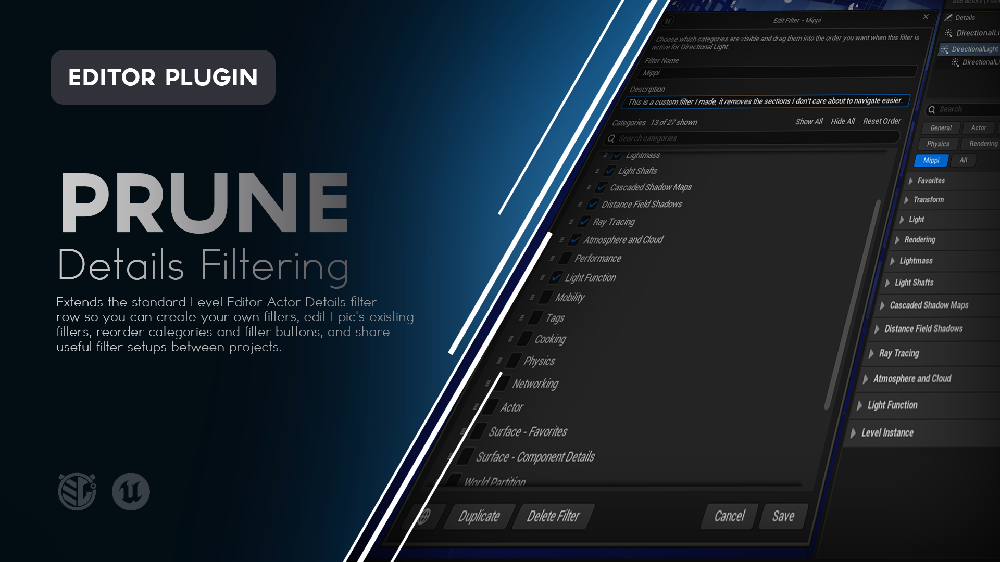

# Prune

**Make Unreal Engine's Actor Details panel work the way you do.**

Unreal's Details panel is great at exposing everything an Actor can do. Finding the handful of categories you actually need? That's another story.

**Prune** lets you create your own filters for the native Actor Details panel—so you can spend less time searching through settings and more time working. Build task-specific views, customize Epic's existing filters, arrange categories in your preferred order, and share useful setups between projects.

**No replacement Details panel. No changes to your Actor properties. Just the controls you need, when you need them.**

---

## Full documentation

> ### **[Explore the Prune Documentation →](https://mippi-the-dork.github.io/Prune/)**
>
> The complete guide to using Prune: installation, creating filters, working with Epic filters, import/export, preferences, examples, technical details, and troubleshooting.
>
> **[Get Started](https://mippi-the-dork.github.io/Prune/?page=01-getting-started%2Ffirst-use%2FDESIGN.md)** · **[Create a Filter](https://mippi-the-dork.github.io/Prune/?page=02-authoring-filters%2Fcreate%2FDESIGN.md)** · **[Filter Manager](https://mippi-the-dork.github.io/Prune/?page=03-managing-filters%2Fmanager%2FDESIGN.md)** · **[All Documentation](https://mippi-the-dork.github.io/Prune/)**

## Your Actor. Your workflow. Your Details panel.

A complex Blueprint might expose categories for **Transform, Rendering, Physics, Collision, Movement, AI, Gameplay, Networking, Audio**, and more.

Different people need different parts of that same Actor:

| Working on… | The categories you'd put first |
| --- | --- |
| **Gameplay** | Transform, Movement, Interaction, Combat, Collision |
| **Environment art** | Transform, Rendering, Materials, Lighting, LOD |
| **Networking** | Actor, Networking, Movement, Physics |
| **Debugging** | Actor, Gameplay, Debug, Collision |

These are *examples*, not fixed built-in Prune presets. You choose which categories belong in each filter, based on the categories that Actor actually exposes.

A **Gameplay** filter keeps gameplay-facing settings in sight. Switch to **Visuals** to work on presentation. Click Unreal's **All** to see the full Details panel again.

Nothing was removed from the Actor. Nothing was reconfigured behind your back. **Prune changes what you see, not what the Actor is.**

## What Prune brings to Unreal

### Create filters for the work you're doing

Add named filters such as **Gameplay**, **Environment**, **AI**, or **Debug** directly beside Unreal's native Details filters. Choose the categories that appear, give the filter an optional description, and drag categories into a useful reading order.

[Creating Custom Filters](https://mippi-the-dork.github.io/Prune/?page=02-authoring-filters%2Fcreate%2FDESIGN.md) · [Choosing Categories](https://mippi-the-dork.github.io/Prune/?page=02-authoring-filters%2Fcategories%2FDESIGN.md) · [Category Ordering](https://mippi-the-dork.github.io/Prune/?page=02-authoring-filters%2Fordering%2FDESIGN.md)

### Make Epic's filters your own

Already like Unreal's **Rendering** or **Physics** filter, but want to adjust what it shows? Prune lets you edit compatible Epic filters through **reversible overrides**. Reset to Epic Default whenever you want the original behavior back.

Or duplicate an Epic filter into an independent Prune filter you can rename and customize without changing the built-in one.

[Editing Epic Filters](https://mippi-the-dork.github.io/Prune/?page=03-managing-filters%2Fepic-filters%2FDESIGN.md)

### Keep filters organized

Use the **Filter Manager** to search, inspect, edit, duplicate, delete, import, export, and reorder the filters available to the current Actor class. Arrange the filter *buttons* to put your favorites first, separately from arranging the *categories* inside a filter.

Prune also adds contextual right-click actions to compatible filter buttons, while preserving Unreal's normal click and Ctrl-click selection behavior.

[Filter Manager](https://mippi-the-dork.github.io/Prune/?page=03-managing-filters%2Fmanager%2FDESIGN.md) · [Filter Buttons and Context Menus](https://mippi-the-dork.github.io/Prune/?page=03-managing-filters%2Ffilter-bar%2FDESIGN.md)

### Filters that fit your project

Choose **Class** scope for filters specific to an Actor family, including derived classes, or **Global** for reusable filters available across Actor types.

Prune also discovers categories added through compatible Details customizations, allowing project-specific and plugin-provided categories to participate when they're present in the Actor's native layout.

[Class and Global Filters](https://mippi-the-dork.github.io/Prune/?page=02-authoring-filters%2Fscopes%2FDESIGN.md)

### Share the useful stuff

Export custom Prune filters to portable **`.prunefilters.json`** files and import them into other projects or Actor classes. Prune uses independent internal IDs and collision-safe names so imports don't silently overwrite your existing filters.

[Importing and Exporting Filters](https://mippi-the-dork.github.io/Prune/?page=03-managing-filters%2Fimport-export%2FDESIGN.md)

---

## Built for the native Unreal Editor

Prune extends the **Level Editor Actor Details** panel rather than introducing a separate properties editor. Your existing Details property controls, Epic filter buttons, and native left-click/Ctrl-click behavior remain in place.

Filter definitions, descriptions, scope, category order, Epic overrides, and per-class button order are kept in the editor's **per-project user settings**. They are not stored on the Actor. Appearance options, including drag-and-drop feedback and default window sizes, are configurable under **Project Settings → Plugins → Prune**.

**Prune is Editor-only.** It adds no runtime gameplay system, no Actor component, and no packaged-game dependency.

[How Prune Works](https://mippi-the-dork.github.io/Prune/?page=04-settings-and-implementation%2Farchitecture%2FTECHNICAL.md) · [Saving and Editor State](https://mippi-the-dork.github.io/Prune/?page=04-settings-and-implementation%2Fpersistence%2FDESIGN.md) · [Preferences](https://mippi-the-dork.github.io/Prune/?page=04-settings-and-implementation%2Fpreferences%2FDESIGN.md)

## Getting Prune

| | |
| --- | --- |
| **Prune** | v1.0.0 |
| **Unreal Engine** | 5.8 |
| **Platform** | Windows 64-bit |
| **Type** | Editor-only plugin |
| **Engine modifications** | None |

Install through a compatible **Fab** listing, use a packaged **[GitHub Release](https://github.com/mippi-the-dork/Prune/releases)**, or build directly from this repository's source.

For the correct plugin folder structure, activation, updating and source-build instructions, see **[Installation and Compatibility](https://mippi-the-dork.github.io/Prune/?page=01-getting-started%2Finstallation%2FDESIGN.md)**.

## What Prune does *not* do

Prune is deliberately a **Details presentation and organization tool**, not a property-editing system.

- It doesn't delete Actor properties or categories, or change property values when they are hidden by a filter.
- It doesn't change gameplay behavior or packaged builds.
- It doesn't replace Unreal's Details panel or native Property Section system.
- It doesn't modify Blueprint Class Defaults or Component Details panels; v1.0 focuses on **Level Editor Actor instance Details**.
- It doesn't make every category available on every Actor. Each Actor still has its own native category layout.
- It doesn't automatically distribute personal filter setups to teammates. Use Import/Export to share presets.

There are a few native filtering boundaries worth knowing: a filter with no populated categories for the selected Actor may not appear in the filter row; newly discovered categories in Epic overrides retain their underlying native behavior until explicitly configured; and when several filters are combined with **Ctrl**, Unreal's native category order takes precedence over a single filter's custom order.

Read the [FAQ and Limitations](https://mippi-the-dork.github.io/Prune/?page=05-support%2Ffaq%2FDESIGN.md) or [Troubleshooting Guide](https://mippi-the-dork.github.io/Prune/?page=05-support%2Ftroubleshooting%2FDESIGN.md) for details.

---

## Bugs, feature requests, and contributions

**Found a bug?** Open a [GitHub Issue](https://github.com/mippi-the-dork/Prune/issues) with your Prune and Unreal versions, Actor class, filter type/scope, reproduction steps, and any relevant screenshots or editor logs.

**Have an idea?** [Request a feature](https://github.com/mippi-the-dork/Prune/issues). Describe the *Details-panel workflow problem* you'd like to solve and why it matters—it's easier to find the best solution when we understand the underlying need.

**Want to contribute?** Pull requests are welcome. For significant changes, please open an Issue first so we can discuss the intended behavior before substantial work begins. Contributions should remain focused on native Actor Details filtering, organization, and presentation.

## License

Prune is distributed under the **MIT License**. See [LICENSE](LICENSE).

---

**Prune** is created by **Mippi the Dork**.

*The Details panel should show the information you need for the job you're doing now.*

**[Explore the documentation](https://mippi-the-dork.github.io/Prune/)** · **[Releases](https://github.com/mippi-the-dork/Prune/releases)** · **[Report an issue](https://github.com/mippi-the-dork/Prune/issues)**.
