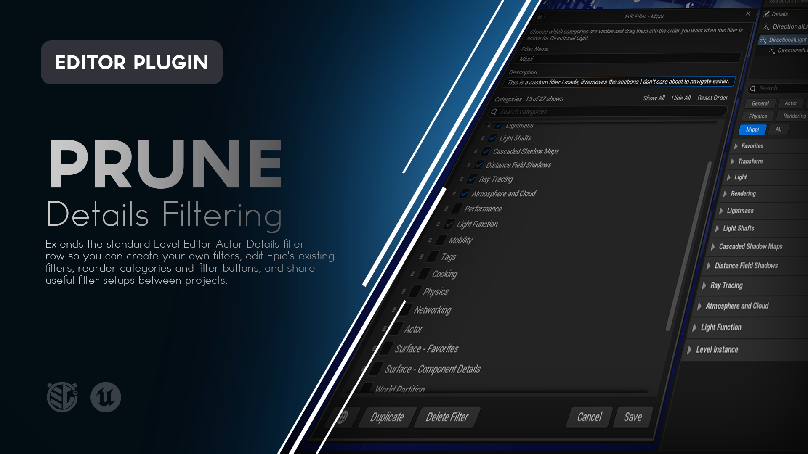

# Prune Documentation

**Prune v1.0.0 · Unreal Engine 5.8.x · Win64 · Editor-only**

Prune lets you **create, edit, organize and share filters for Unreal Engine's native Actor Details panel**. Build a focused view for a gameplay, art or technical workflow without changing the selected Actor's property values.

*Prune extends Unreal's standard Actor Details filter row with customizable category views and native filter management.*

## What can I do with Prune?

**Create custom filters:** Give frequently used category groups names such as Gameplay, Visuals or Debug.

**Keep control of Epic filters:** Edit compatible built-in Property Sections through reversible overrides, or duplicate them into independently editable custom filters.

**Organize the Details panel:** Include and reorder categories, choose Class or Global scope, and rearrange filter buttons per Actor class.

**Share useful presets:** Import and export custom filter definitions through portable `.prunefilters.json` files.

**Stay in Unreal:** All of this works inside the native Level Editor Actor Details workflow. Prune does not replace the Details panel, modify Actor values or add packaged runtime systems.

## Get started in three steps

1. [Install Prune](01-getting-started/installation/DESIGN.md) for the supported Unreal Engine editor.
2. Select an Actor and follow [Your First Filter](01-getting-started/first-use/DESIGN.md).
3. Learn how to [author filters](02-authoring-filters/README.md) and [manage existing filters](03-managing-filters/README.md).

## Which guide do I read?

Read **Design** for controls, user steps, intended outcomes, edge cases and everyday troubleshooting. Read **Technical** for the C++ implementation, native Unreal Editor integration, stored identifiers, scope resolution and constraints.

## Explore the manual

| Category | Topics | What you'll find |
| --- | ---: | --- |
| [01. Getting Started](01-getting-started/README.md) | 3 | Purpose, compatibility, installation and first filter |
| [02. Authoring Filters](02-authoring-filters/README.md) | 5 | Create, search, order, scope, edit and duplicate filters |
| [03. Managing Filters](03-managing-filters/README.md) | 4 | Epic overrides, manager, native filter bar and import/export |
| [04. Settings and Implementation](04-settings-and-implementation/README.md) | 3 | Appearance, editor-user state and architecture |
| [05. Support and Troubleshooting](05-support/README.md) | 2 | Common problems, FAQ, updating and help |

## Prune's limits

Prune changes **which Details categories you see and in what order**, not the Actor data itself. Filters rely on categories available in the current Actor's native Details layout. Class-scoped filters follow compatible class relationships, while Global filters may be available across different Actors without inventing missing properties. Multiple Ctrl-selected filters use Unreal's native combined behavior.

Prune is editor-only. Per-project user filter state is not automatically embedded in the Actor or distributed to teammates; use [Import and Export](03-managing-filters/import-export/DESIGN.md) for intentional sharing.

## Product direction

The [Roadmap](ROADMAP.md) identifies v1.0.0 as the released baseline and separates possible future enhancements from actual commitments. The [documentation audit](DOCUMENTATION_AUDIT.md) and [verification matrix](VERIFICATION_MATRIX.md) track remaining gaps and test results.

## Project and support

- [Prune repository](https://github.com/mippi-the-dork/Prune)
- [Releases](https://github.com/mippi-the-dork/Prune/releases)
- [Report an issue](https://github.com/mippi-the-dork/Prune/issues)

**Documentation basis:** Prune v1.0.0 README, plugin descriptor, and C++ source. Behavior was source-reviewed; full live UE 5.8 and website QA results are not claimed.
